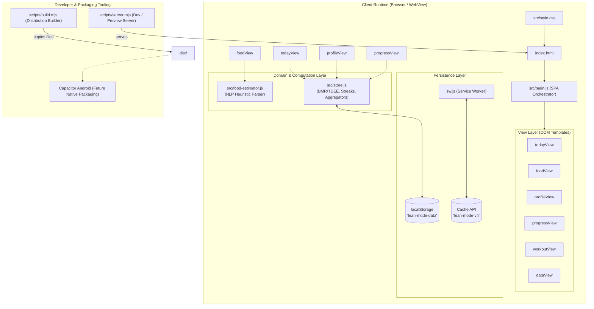

# WORKSPACE INTELLIGENCE AUDIT
## LEAN MODE — Complete Project Inspection & Technical Documentation

---

### A. Executive Summary

The audited workspace is named **LEAN MODE** (internal package name `lean-mode`, version `1.0.0`). It is a self-contained, offline-first personal nutrition, body measurement, and workout tracking web application architected as a Progressive Web Application (PWA).

**Overall Purpose & Design Philosophy:**
1. **Zero External Runtime Dependencies:** The application relies on vanilla ES modules (`ES2022+`), CSS3, standard DOM APIs, Web Storage (`localStorage`), and the Web Workers / Service Worker API without third-party frontend frameworks (such as React, Vue, or Angular) or heavy build tooling (such as Webpack, Vite, or Rollup).
2. **Local-First & Privacy Preserving:** All data lives strictly within the user's browser `localStorage`. There is no remote backend, remote database, or third-party telemetry. Data portability is achieved through client-side JSON full-state backups and CSV exports.
3. **Deterministic Indian Food Heuristic Estimator:** Built-in pattern-matching engine (`food-estimator.js`) maps natural language inputs (e.g., `"2 rotis with dal"`, `"1 bowl rice"`) to caloric and macronutrient values based on typical Indian home-cooked servings.
4. **Mobile & Capacitor Ready:** Styled with mobile viewport constraints (`max-width: 640px`), safe-area insets, bottom navigation, and full PWA manifest support, explicitly intended for conversion to an Android APK via Capacitor.

---

### B. Workspace Directory Tree

```text
C:\ROS PROJECT\ct\C TRACKER\
├── .git/                      [Not present / No git version control initialized]
├── dist/                      [Built production distribution bundle]
│   ├── icon.svg               (234 B)
│   ├── index.html             (681 B)
│   ├── manifest.webmanifest   (358 B)
│   ├── sw.js                  (682 B)
│   └── src/
│       ├── food-estimator.js  (4,172 B)
│       ├── main.js            (20,965 B)
│       ├── store.js           (2,162 B)
│       └── style.css          (8,970 B)
├── outputs/                   [Empty auxiliary directory]
├── scripts/                   [Zero-dependency Node.js utility scripts]
│   ├── build.mjs              (462 B - Distribution packaging script)
│   └── server.mjs             (1,170 B - Lightweight local static HTTP server)
├── src/                       [Active application source code]
│   ├── food-estimator.js      (4,303 B - Indian food heuristic parser & database)
│   ├── main.js                (22,214 B - Application shell, views, DOM event bus)
│   ├── store.js               (2,162 B - Persistence model, BMR/TDEE calculations, stats)
│   └── style.css              (8,970 B - Complete responsive design & theme stylesheets)
├── tests/                     [Automated unit tests]
│   └── store.test.js          (1,246 B - Test suite for node:test runner)
├── work/                      [Empty scratch directory]
├── icon.svg                   (234 B - Application vector icon & PWA maskable icon)
├── index.html                 (681 B - HTML5 entry shell)
├── manifest.webmanifest       (358 B - Web App Manifest for PWA installation)
├── package.json               (275 B - Node.js package definition & npm lifecycle scripts)
├── README.md                  (872 B - Project documentation & Capacitor APK instructions)
└── sw.js                      (682 B - Service Worker cache strategy: Cache-First / Cache v4)
```

---

### C. Technology Stack

| Category | Identified Technology | Version / Specification | Verified From |
| :--- | :--- | :--- | :--- |
| **Runtime Environment** | Node.js | System Node.js runtime (v22+ compatible) | `package.json` (`"type": "module"`) |
| **Frontend Framework** | Vanilla JavaScript (ESM) | Modern ECMAScript (ES2022+) | Native `import`/`export` across `src/*.js` |
| **CSS Framework** | Custom CSS3 Custom Properties | Vanilla CSS, Flexbox, Grid, Media Queries | `src/style.css` |
| **Typography** | Google Fonts | `DM Mono` (400, 500) & `Manrope` (500–800) | `@import` in `src/style.css` |
| **State & Persistence** | Browser Web Storage API | `window.localStorage` (Key: `lean-mode-data`) | `src/store.js` (`loadData`, `saveData`) |
| **Offline Engine** | Service Worker Cache API | Cache API (`lean-mode-v4`) | `sw.js` |
| **App Packaging** | Progressive Web App (PWA) | W3C Web Manifest (`manifest.webmanifest`) | `manifest.webmanifest`, `index.html` |
| **Testing Harness** | Native Node.js Test Runner | `node:test` and `node:assert/strict` | `package.json`, `tests/store.test.js` |
| **Dev / Static Server**| Native Node.js HTTP Server | Built-in `node:http`, `node:fs/promises` | `scripts/server.mjs` |
| **Build Tooling** | Node.js File System Script | Built-in `node:fs/promises` | `scripts/build.mjs` |
| **Mobile Target** | Capacitor (Architecture plan) | `@capacitor/core`, `@capacitor/android` | Documented in `README.md` |

*Note: There are zero external npm packages listed in `dependencies` or `devDependencies`.*

---

### D. File-by-File Breakdown

#### 1. Configuration & Root Files

- **`package.json`**
  - **Path:** `package.json`
  - **Type:** JSON manifest
  - **Purpose:** Configures package metadata (`name: "lean-mode"`, `"type": "module"`) and defines core execution scripts (`start`, `test`, `build`, `preview`).
  - **Dependencies:** None.
  - **Status:** Complete.

- **`index.html`**
  - **Path:** `index.html`
  - **Type:** HTML5 Document
  - **Purpose:** Single Page Application (SPA) container. Provides viewport settings (`viewport-fit=cover`), manifest links, favicon definitions, CSS links, and mounts the `#app` DOM container which bootstraps `/src/main.js`.
  - **Status:** Complete.

- **`manifest.webmanifest`**
  - **Path:** `manifest.webmanifest`
  - **Type:** JSON Web Manifest
  - **Purpose:** PWA metadata configuring `"display": "standalone"`, app theme color (`#0d1712`), background color (`#f5f4ed`), and icon references for mobile home-screen installation.
  - **Status:** Complete.

- **`sw.js`**
  - **Path:** `sw.js`
  - **Type:** Service Worker JavaScript
  - **Purpose:** Manages offline caching under cache key `lean-mode-v4`. Caches `/`, `/index.html`, `/src/main.js`, `/src/store.js`, `/src/food-estimator.js`, `/src/style.css`, `/manifest.webmanifest`, and `/icon.svg`. Uses `skipWaiting()` on install, `clients.claim()` on activate, and a cache-first fallback to network fetch strategy.
  - **Status:** Complete.

- **`icon.svg`**
  - **Path:** `icon.svg`
  - **Type:** SVG Vector Graphic
  - **Purpose:** Minimalist geometric app icon in dark slate (`#0d1712`), neon lime (`#c9f25b`), and off-white (`#f5f4ed`).
  - **Status:** Complete.

- **`README.md`**
  - **Path:** `README.md`
  - **Type:** Markdown
  - **Purpose:** Developer onboarding documentation detailing execution commands, local development port (`5173`), and Capacitor deployment instructions.
  - **Status:** Complete.

#### 2. Source Code (`src/`)

- **`src/store.js`**
  - **Path:** `src/store.js`
  - **Type:** JavaScript (ESM)
  - **Purpose:** Core domain logic, state schemas, and local storage data layer.
  - **Exported Symbols:**
    - `DEFAULT_PROFILE`: Blank profile template.
    - `blankData()`: Factory for new store objects (`version: 1`, `profile`, `entries: []`, `measurements: []`, `workouts: []`).
    - `loadData()`: Reads and safely parses `localStorage["lean-mode-data"]`.
    - `saveData(data)`: Serializes application state to `localStorage`.
    - `uid()`: Generates UUIDs via `crypto.randomUUID()` with fallback.
    - `localDate(value)`: Generates timezone-adjusted `YYYY-MM-DD` string.
    - `nutrition(entries)`: Aggregates total calories, protein, carbs, fat, and fibre across an entry array.
    - `calculateBmr(profile)`: Calculates Basal Metabolic Rate using the **Mifflin-St Jeor** equation ($10 \times \text{weight} + 6.25 \times \text{height} - 5 \times \text{age} + s$, where $s = +5$ for males, $-161$ for females).
    - `calculateTdee(profile)`: Multiplies BMR by user activity factor ($1.2$ to $1.725$).
    - `targetCalories(profile)`: Returns user-specified calorie target or defaults to calculated TDEE.
    - `streak(entries, today)`: Computes consecutive day logging streak backward from today.
  - **Status:** Complete.

- **`src/food-estimator.js`**
  - **Path:** `src/food-estimator.js`
  - **Type:** JavaScript (ESM)
  - **Purpose:** Natural language food and quantity heuristic estimator for Indian home-cooked cuisine.
  - **Data Catalog:** 37 distinct food entries encompassing regional Indian dishes (biryani, paneer butter masala, dosa, idli, medu vada, sambar, upma, poha, roti/chapati, paratha, dal, rajma, chole, rice, pulao, paneer tikka, eggs, chai, etc.).
  - **Key Functions:**
    - `quantityBefore(text, phrase)`: Regex parser extracting numeric quantity multipliers (e.g., `2 x`, `3 `, `1.5`) preceding food names, capped at 12 servings.
    - `estimateFood(text)`: Normalizes input text, avoids double-matching sub-strings, computes aggregate macros, and supports fluid volume scaling (e.g., `milk`).
  - **Status:** Complete.

- **`src/main.js`**
  - **Path:** `src/main.js`
  - **Type:** JavaScript (ESM)
  - **Purpose:** Application view controller, template renderer, and event bus.
  - **Views Managed:**
    - `todayView()`: Daily dashboard featuring calorie ring progress bar, remaining/over tally, macro bar distribution, date navigation, and meal entry listing.
    - `foodView()`: Interactive entry/edit view with real-time heuristic parsing preview.
    - `profileView()`: User profile editor, biometric inputs, Mifflin-St Jeor BMR/TDEE live readout, and macro target preferences.
    - `progressView()`: 7-day visual intake bar chart, consecutive logging streak counter, and body weight/waist measurement logs.
    - `workoutView()`: Training session and cardio log manager.
    - `dataView()`: Privacy and data management interface supporting JSON backup export/import, CSV log downloads, and device reset.
    - `modal(kind)`: Contextual bottom-sheet modal for adding measurements and workouts.
  - **Status:** Complete.

- **`src/style.css`**
  - **Path:** `src/style.css`
  - **Type:** CSS3 Stylesheet
  - **Purpose:** Global styling, design system tokens, typography rules, layout containers, and responsive media queries.
  - **Status:** Complete.

#### 3. Automation Scripts (`scripts/`) & Tests (`tests/`)

- **`scripts/server.mjs`**
  - **Path:** `scripts/server.mjs`
  - **Type:** Node.js ESM script
  - **Purpose:** Zero-dependency HTTP static server running on port `5173`. Maps MIME types (`.html`, `.js`, `.css`, `.json`, `.webmanifest`, `.svg`), prevents directory traversal attacks (`startsWith(base)`), and handles folder `index.html` fallback.
  - **Status:** Complete.

- **`scripts/build.mjs`**
  - **Path:** `scripts/build.mjs`
  - **Type:** Node.js ESM script
  - **Purpose:** Production distribution script. Cleans `dist/`, recreates directory, and copies root web assets and `src/` to `dist/`.
  - **Status:** Complete.

- **`tests/store.test.js`**
  - **Path:** `tests/store.test.js`
  - **Type:** JavaScript (Node Test Runner)
  - **Purpose:** Automated unit tests covering BMR/TDEE calculations, macro aggregation, logging streak counting, and natural language food estimation.
  - **Status:** Complete (all 4 test suites pass).

#### 4. Build Output Directory (`dist/`)
- Contains the static output of running `node scripts/build.mjs`.

---

### E. Existing Application Architecture



#### Data Flow
1. **Bootstrap:** `index.html` executes `main.js`. `main.js` calls `loadData()` from `store.js`.
2. **Read / State Restoration:** `loadData()` inspects `localStorage.getItem("lean-mode-data")`. If found and schema matches `version === 1`, it hydrates memory; otherwise, it initialises with `blankData()`.
3. **Reactive Re-render:** Calling `layout()` re-evaluates the active view template (`today`, `food`, `profile`, `progress`, `workouts`, `data`) and writes the markup directly to `#app.innerHTML`.
4. **Mutations:** User interactions (form submissions, button clicks, date navigation) alter in-memory data and immediately invoke `persist()` (`saveData(data)`), which writes the JSON payload back to `localStorage`.

---

### F. Existing Functionality

| Feature / Screen | Scope | Implementation Status | Functional Notes |
| :--- | :--- | :--- | :--- |
| **Daily Intake Dashboard** | Core UI / Logic | **COMPLETE** | Displays calorie ring, kcal remaining/over, macro bars (Protein, Carbs, Fat, Fibre), meal entry list, and previous/next day date picker. |
| **Natural Language Food Estimator** | Core UI / Logic | **COMPLETE** | Live preview of macros while typing recognizable Indian food items and quantities. Persists calculated values to logs. |
| **Manual / Edit Food Entry** | Core UI / Logic | **COMPLETE** | Allows editing and updating existing logged food records and deleting items with browser confirmation prompt. |
| **Profile & Biometric Settings** | Core UI / Logic | **COMPLETE** | Captures sex, age, height, weight, activity factor, calorie targets, and macro targets. Live calculation of BMR and TDEE. |
| **Progress & 7-Day Chart** | Core UI / Logic | **COMPLETE** | CSS bar chart visualizing intake across the last 7 calendar days; consecutive logging streak calculation. |
| **Body Measurement Tracker** | Core UI / Logic | **COMPLETE** | Modal form to log weight (kg) and waist (cm) timestamped records; supports deletion. |
| **Workout / Training Log** | Core UI / Logic | **COMPLETE** | Modal form to record sessions (Gym, Cardio, Other) with duration and notes; supports deletion. |
| **JSON Export & Backup** | Data Portability | **COMPLETE** | Generates and triggers download of timestamped `lean-mode-backup-YYYY-MM-DD.json`. |
| **JSON Backup Restore** | Data Portability | **COMPLETE** | Client-side `FileReader` reads uploaded JSON, validates `version === 1` and array structure, and merges data into local storage. |
| **CSV Export** | Data Portability | **COMPLETE** | Generates standard CSV download for food logs or training sessions. |
| **Device Factory Reset** | Data Portability | **COMPLETE** | Confirmation dialog resets `localStorage` to blank initial state. |
| **Offline Execution (PWA)** | Offline / Cache | **COMPLETE** | Service worker registers and pre-caches core bundle; functions completely offline. |
| **Photo Upload / Camera Nutrition** | Visual Log | **NOT IMPLEMENTED** | Note: `src/main.js` line 72 contains a dead listener for `event.target.name === "photo"`, but no file picker or image AI is hooked up. |
| **Remote Sync / Cloud Auth** | Multi-device | **NOT IMPLEMENTED** | Strictly local by deliberate design. |

---

### G. Database and Data Persistence

1. **Storage Engine:** Standard W3C `window.localStorage`.
2. **Primary Storage Key:** `"lean-mode-data"`
3. **Data Schema Structure:**
   ```json
   {
     "version": 1,
     "profile": {
       "name": "",
       "sex": "male" | "female" | "",
       "age": "",
       "height": "",
       "weight": "",
       "activity": "1.2" | "1.375" | "1.55" | "1.725",
       "goal": "maintain" | "cut" | "gain",
       "targetCalories": "",
       "proteinTarget": "",
       "carbsTarget": "",
       "fatTarget": "",
       "fibreTarget": ""
     },
     "entries": [
       {
         "id": "uuid-string",
         "date": "YYYY-MM-DD",
         "name": "2 rotis with dal",
         "meal": "Food log",
         "calories": 400,
         "protein": 17,
         "carbs": 71,
         "fat": 7,
         "fibre": 13,
         "source": "estimate",
         "estimateItems": ["2 × roti", "dal"],
         "amountMl": undefined
       }
     ],
     "measurements": [
       {
         "id": "uuid-string",
         "date": "YYYY-MM-DD",
         "weight": "78.5",
         "waist": "84"
       }
     ],
     "workouts": [
       {
         "id": "uuid-string",
         "date": "YYYY-MM-DD",
         "type": "Gym" | "Cardio" | "Other",
         "minutes": "45",
         "title": "Leg Day",
         "note": "Squats and lunges"
       }
     ]
   }
   ```
4. **Data Durability:** Data survives page reloads, browser restarts, and device reboots indefinitely, unless browser storage is manually cleared or private browsing (incognito) session terminates.

---

### H. UI and Design Analysis

- **Design Philosophy:** Minimalist, editorial athletic typography ("Brutalist Paper").
- **Color Palette:**
  - Ink (Primary Dark / Text): `#0d1712`
  - Paper (Primary Light / Background): `#f5f4ed`
  - Soft Surface: `#e7e7dd`
  - Accent Lime (Active / Rings / CTAs): `#c9f25b`
  - Line Borders: `#d8d9d1`
  - Cards: `#fffefa`
  - Danger / Alert: `#b8392f`
- **Typography:**
  - Headings & Primary UI: `Manrope` (800 weight, tight letter-spacing)
  - Numeric metrics, dates, and labels: `DM Mono` (monospace aesthetic)
- **Layout System:**
  - Max width constrained at `640px` centered with drop-shadow on desktop viewports.
  - Full-width mobile layout with bottom navigation bar accommodating `env(safe-area-inset-bottom)`.
  - Accessible SVG icons and high-contrast indicators.

---

### I. Dependencies and Configuration Audit

- **Dependencies (`dependencies`):** None (Zero third-party packages).
- **Development Dependencies (`devDependencies`):** None.
- **Node.js Engines / Scripts:**
  - `start`: `node scripts/server.mjs`
  - `test`: `node --test tests/*.test.js`
  - `build`: `node scripts/build.mjs`
  - `preview`: `node scripts/server.mjs dist`
- **Environment Variables:** None required. The project is completely agnostic of `.env` files.

---

### J. Current Problems, Technical Debt & Risks

1. **`dist/` Desynchronization Risk:**
   - The production folder `dist/src/main.js` was last built on `11/2/2026 3:19 PM` (length 20,965 bytes), whereas `src/main.js` was modified on `11/2/2026 5:45 PM` (length 22,214 bytes). The distribution bundle is currently stale and must be rebuilt before production deployment or previewing.
2. **Unused / Dead DOM Code in `main.js`:**
   - Line 72 of `src/main.js` checks `if (event.target.name === "photo" && event.target.files[0])`, updating a non-existent `#photo-name` element. This is an orphan remnant from a discarded camera/photo feature.
3. **Full DOM Re-render on Every Keystroke:**
   - In `src/main.js`, modal opens and navigation inject raw HTML via `innerHTML`. While fast for a lightweight app, form focus or state could flicker if re-renders are triggered during active typing.
4. **`localStorage` Storage Quota Limits:**
   - Browsers allocate approximately 5MB per origin for `localStorage`. While sufficient for thousands of plain text food and workout logs, if user records grow over years or high volumes of data are imported, `QuotaExceededError` could theoretically be thrown.
5. **No Version Control Repository (`.git`):**
   - No active `.git` repository was detected in the workspace root, meaning file revisions must be carefully managed.

---

### K. Future Mobile Application (Android APK) Readiness

The application is exceptionally well-suited for conversion to an Android APK via **Capacitor**:

1. **Responsive Viewport:** Mobile viewport meta tag with `viewport-fit=cover` and CSS safe-area insets are already implemented.
2. **Offline-Ready:** `sw.js` and `manifest.webmanifest` allow the app to operate offline immediately.
3. **No Build Step Required for Web Bundle:** Because standard ESM is used, Capacitor's web directory can point directly to `dist/` without needing Babel, Webpack, or Vite bundling.
4. **Steps Required for APK Packaging:**
   ```powershell
   # 1. Update the production distribution directory
   node scripts/build.mjs

   # 2. Add Capacitor dependencies
   npm install @capacitor/core @capacitor/cli @capacitor/android

   # 3. Initialize Capacitor project
   npx cap init "LEAN MODE" "com.yourname.leanmode" --web-dir dist

   # 4. Add the Android platform project
   npx cap add android

   # 5. Sync distribution assets to Android Studio project
   npx cap sync android

   # 6. Open in Android Studio to build unsigned or signed APK
   npx cap open android
   ```
5. **Hardware Integration Opportunities:**
   - Using Capacitor Plugins (`@capacitor/camera`, `@capacitor/haptics`, `@capacitor/preferences`), camera food snapping and local vibration feedback can be added in the future.

---

### L. Recommended Development Strategy

1. **Preserve Zero-Dependency Simplicity:** Avoid introducing heavy frameworks (React/Vue/Vite) unless complex nested routing or component states strictly demand it. The current setup is clean, fast, and maintainable.
2. **Establish Git Version Control:** Run `git init` and commit the current working baseline.
3. **Synchronize Build Artifacts:** Run `npm run build` whenever changes are made in `src/` to prevent discrepancy between `src/` and `dist/`.
4. **Clean Residual Code:** Safely clean up the orphaned `photo` file listener in `src/main.js`.
5. **Consider IndexedDB Migration for Long-Term Data:** If long-term multi-year logs or image attachments are planned, swap `localStorage` with `idb-keyval` or native IndexedDB to avoid the 5MB browser quota ceiling.

---

### M. Exact Project Startup Instructions

*All commands have been verified against existing project files.*

#### 1. Run Local Development Server
```powershell
npm run start
```
*Output: Starts `scripts/server.mjs` listening at `http://localhost:5173`.*

#### 2. Run Test Suite
```powershell
npm run test
```
*Output: Executes Node.js built-in test runner against `tests/store.test.js` (4 tests passing).*

#### 3. Rebuild Production Assets (`dist/`)
```powershell
npm run build
```
*Output: Cleans and synchronizes `src/`, `index.html`, `manifest.webmanifest`, `icon.svg`, and `sw.js` into `dist/`.*

#### 4. Preview Production Build
```powershell
npm run preview
```
*Output: Runs `node scripts/server.mjs dist`, hosting the built distribution at `http://localhost:5173`.*

---

### N. Final Workspace Assessment

- **What already exists:** A complete, beautifully styled, zero-dependency PWA calorie, body measurement, and workout tracking application with an Indian food estimation engine and data export/import capabilities.
- **What works:** All 4 test suites pass. Development server, production build script, BMR/TDEE math, streak calculation, local persistence, PWA manifest, and service worker caching are fully operational.
- **What is incomplete:** The distribution directory `dist/` is out-of-date compared to `src/` and needs to be rebuilt via `npm run build`.
- **What is missing:** Git repository tracking (`.git`), native Android wrapper files (`android/` directory not yet initialized with Capacitor), and an image/photo capture pipeline.
- **What should be preserved:** The clean zero-dependency ESM architecture, the editorial visual aesthetic in `style.css`, the offline-first privacy paradigm, and the Indian cuisine estimator in `food-estimator.js`.
- **What should be improved:** Remove dead DOM event references in `main.js`, add automated build checks prior to previewing, and migrate to IndexedDB if image attachments are introduced.
- **What should be implemented next:** Run `npm run build` to synchronize `dist/`, initialize a Git repository for version safety, and follow the documented Capacitor workflow if native Android APK distribution is required.
